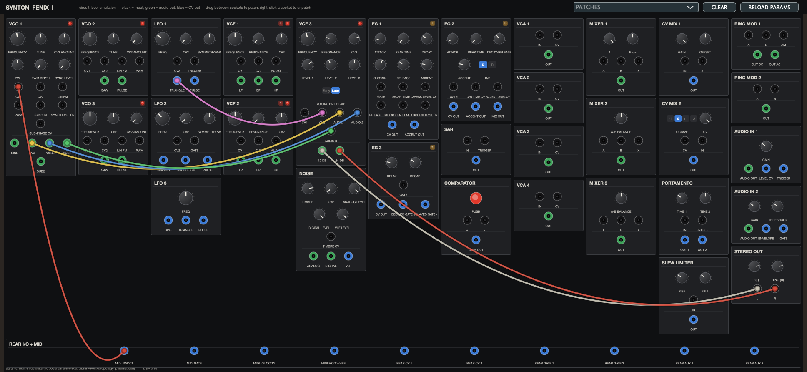

# Synton Fénix I — circuit-level software emulation

An unofficial, non-commercial AU / VST3 / CLAP emulation of the **Synton Fénix (I)**
semi-modular (1997–2000, 75 units, Marc Paping + Bert Vermeulen), built from the
engineering brief in `docs/` — designer documentation, the Sound On Sound review
(Feb 1999), the Fénix II PP manual's shared conventions, and owner reports. No
schematics of any Fénix have been published, so every block is a *topology-level*
model driven by the designer's parts list and trimmer descriptions, with every
inferred constant exposed in a JSON file rather than baked into the DSP.

| Plugin | Type | Formats |
|---|---|---|
| **Fenix I** | Instrument (`aumu Fnx1 Rnky`) | AU · VST3 · CLAP · Standalone |
| **Fenix I FX** | Effect with the two ¼" audio inputs + rear CV bus (`aumf FnxF Rnky`) | AU · VST3 · CLAP · Standalone |

> **Install:** grab an installer from the
> [Releases page](https://github.com/mark-renker/fenix-emulation/releases): a macOS
> `.pkg` (Apple Silicon + Intel, all formats) or a Windows zip. Step-by-step
> instructions, including the one-time Gatekeeper step for the unsigned installer,
> are in [`packaging/INSTALL.md`](packaging/INSTALL.md).



## What is modelled

All 31 panel modules with the designer's names, 64 pots, 4 switches and 144 front
sockets, plus a software rear-I/O node (the six rear 3.5 mm jacks and a MIDI-to-CV
adaptor — the real instrument has no MIDI). Nothing sounds until it is patched.

* **Unified signal rate.** Every connection is a sample-rate voltage (audio ±2 V,
  CV −4…+4 V / 0…+8 V, gates 0/+8 V, op-amp clip at ±13.5 V with a soft knee).
  Audio-rate modulation of filters, VCAs, S&H and ring mods is the instrument's
  main attraction and is first-class here: there is no control-rate decimation.
* **Oversampling.** The whole graph runs at 2× the host rate; VCO cores and the
  VCF3 ladder run at 4× internally with half-band decimation. VCOs use 4-point
  polyBLEP steps (saw, pulse, sub-dividers, sync resets) and a polyBLAMP
  triangle; aliased components measure < −110 dB at a 48 kHz host.
* **Feedback patching.** Any output may feed any input, including itself. A graph
  scheduler orders the modules topologically; each edge that closes a cycle gets a
  one-sample delay at the engine rate (10.4 µs at 48 kHz) and is reported.
* **Banana stacking.** Several cables into one input sum. Two *outputs* tied together
  form a net that resolves to the current-limited node voltage (KCL with per-driver
  source/sink limits) — deterministic, never a sum.
* **VCO1/2/3** — expo converter (1 V/oct, exact by default, optional 'vintage'
  errors and HF droop), sawtooth core with reset time, comparator PWM with the
  ±4 V window, discrete sine shaper (1–3 % THD, odd-harmonic), hard/soft sync
  with a continuous window, sub-oscillators behind the sub-phase one-shot delay
  (pitch shifts while the phase moves, exactly as the II PP manual describes),
  linear FM that stalls at 0 Hz (through-zero exposed, off).
* **LFO1–3** — integrator/Schmitt relaxation oscillators with symmetry via
  split charge/discharge currents, phase-continuous resets and gate hold.
* **VCF1/VCF2** — zero-delay-feedback OTA state-variable filters (CA3280 class);
  OTA tanh on both integrator inputs, bounded self-oscillation whose level stays
  flat across the sweep (the designer's calibration criterion).
* **VCF3** — five-stage transistor ladder (tanh every stage), '12 dB' tap at
  stage 2 inside the loop, '24 dB' output that is really 5-pole (~30 dB/oct),
  3-input log-pot mixer whose drive shapes the saturation, resonance calibrated
  so self-oscillation starts at the designer's '10 o'clock', and an
  **early/late voicing** switch for the 'Moog-ish' production retune.
* **EG1/EG2/EG3** — RC attack toward an overshoot target, timer-based peak hold,
  CV-steerable exponential decay/release (1 V ≈ ×2), 'Accent' decay-only
  envelopes, EG2 mix output, EG3 delay-then-AD with delayed-gate ± outputs.
* **VCA ×4, mixers, CV mixers (exact 1.000 V octave steps), portamento (one input,
  two lags, enable gate), slew limiter, S&H with droop, LM311 comparator,
  RM1/RM2 four-quadrant multipliers with trimmed carrier leak and RM1's 'am'
  cleanfeed input, analog/digital (43-bit LFSR, VC clock) / VLF noise, audio-in
  processors (envelope follower, trigger, gate), stereo output.**

## Building

Requirements: macOS (arm64 tested), CMake ≥ 3.22, Xcode command-line tools.
JUCE 8 is used from `~/JUCE` if present (or `-DFENIX_JUCE_PATH=...`), otherwise
fetched; `clap-juce-extensions` is fetched automatically (`-DFENIX_BUILD_CLAP=OFF`
to skip).

```bash
cmake -S . -B build -DCMAKE_BUILD_TYPE=Release
cmake --build build -j
./build/fenix_harness                 # measurement harness, writes fenix_report.json
./build/fenix_harness --dump-params resources/topology_params.json
```

Plugins land in `build/FenixI_artefacts/Release/{AU,VST3,CLAP,Standalone}` (and
`FenixIFX_artefacts`). Copy the bundles into `~/Library/Audio/Plug-Ins/{Components,VST3,CLAP}`
and ad-hoc sign them (`codesign --force --deep -s - <bundle>`), then
`auval -v aumu Fnx1 Rnky`. Or run `packaging/make_installer.sh --build` to get the
same `.pkg` the Releases page ships (universal; add `-DFENIX_ARCHS=arm64` to the
cmake line for a faster native-only dev build). Tagging `v*` builds and publishes a
release through `.github/workflows/release.yml`.

## Topology parameters (retuning without recompiling)

`resources/topology_params.json` lists every [MOD]/[LOW]/[UNK] constant from the
brief — OTA Vt per stage, ladder voicing/compensation, ring-mod leak, S&H droop,
EG overshoot target, LFSR length, noise tilt, output R/I-limit, the 'vintage'
macro… — with its default, its evidence level and a note. Copy it to

```
~/Library/Application Support/FenixI/topology_params.json
```

edit values, and press **RELOAD PARAMS** in the plugin (or restart). The harness
accepts the same file: `fenix_harness --params my_params.json`, so a retune
against hardware recordings is verified by the same tests.

## Verification harness

`fenix_harness` runs the brief's §7 plan headlessly on every build (65 checks,
`ctest` runs the quick variant): 1 V/oct tracking over 8 octaves (±0.1 cent per
octave), sine THD and odd-harmonic dominance, sub-phase vibrato and zero DC pitch
error, hard/soft sync spectra, VCF1/2 slopes and flat self-oscillation level,
VCF3 2-pole tap vs 5-pole slope and resonance-dependent passband, aliasing < −80 dB,
ring-mod products and carrier leak, LFSR period and sin(x)/x spectrum, EG timing
(< 1 ms … > 50 s) and curve shapes, feedback-loop stability with the delayed edge
reported, input vs output stacking, utility laws, LFO ranges, op-amp clipping, and
the CPU budget for a patch using all 31 modules (< 15 % of one core at 48 kHz,
64-sample blocks). See `docs/VERIFICATION.md` for the latest report.

## Using it

Load **Fenix I** on an instrument track, open **PATCHES**, pick one (the JonDent
VCO1 → VCF3 stereo-filter test patch and SOS-style patches are included), play
MIDI. Drag between sockets to patch; outputs can be stacked onto inputs; right-click
a socket to remove cables. The heater LEDs on the VCOs and VCFs go red → green
over the first minute (cosmetic). The FX variant exposes the two ¼" audio inputs
on its main input bus and the rear CV jacks on a sidechain bus (1.0 = 8 V).

## Documents

* `docs/Fenix_I_Emulation_Engineering_Brief.pdf` — the brief this implements.
* `docs/MODULES.md` — module-by-module reference: ports, controls, model, parameters.
* `docs/DEVIATIONS.md` — every place a [MOD]/[LOW]/[UNK] choice was made, and the
  open unknowns the brief asks to close (board overlays, owner recordings, designer
  questions).
* `docs/VERIFICATION.md` — the harness report.

## Legal

Fan-made, unofficial, for personal and research use. Not affiliated with, endorsed
by, or connected to Synton, Marc Paping, Bert Vermeulen, DutchSynth or Patch Point.
MIT licence for the code.
